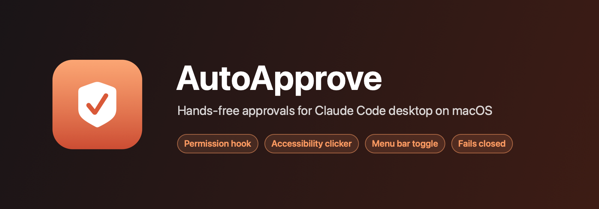
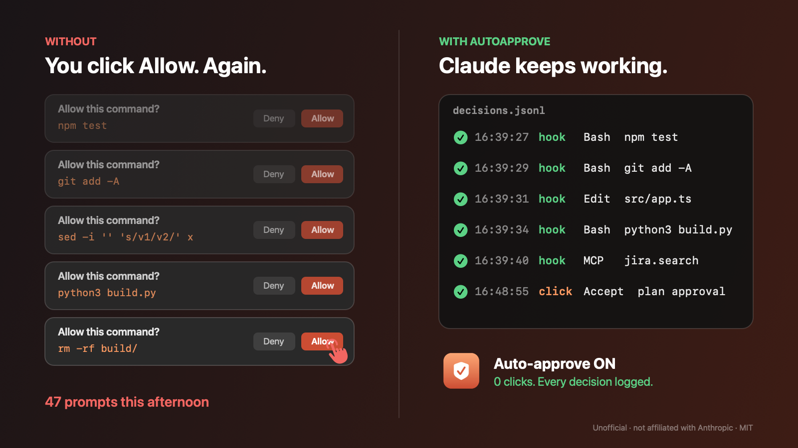
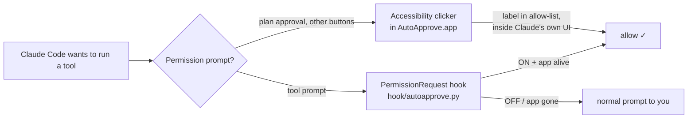
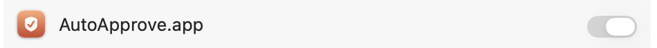

# AutoApprove for Claude Code desktop (macOS)

A small menu bar app plus a Claude Code hook. While you switch it on, it approves the permission prompts in the **Claude Code desktop app** for you. Turn it off and every prompt comes back.



**See it work.** A real Claude Code desktop session in plan mode. The clicker accepts the plan, and the hook allows the edit and test commands. Nobody clicks anything.


▶ [Watch the 40-second promo video](docs/media/autoapprove-promo.mp4)

> **Unofficial.** This is a personal tool. It is not affiliated with or endorsed by Anthropic. "Claude" and "Claude Code" are Anthropic's trademarks.

> ⚠️ **Read before use.** While it is ON, the tool approves **everything** it can see. That includes `git push --force`, `rm -rf`, publishing, and commands that match your `ask` rules. The menu bar toggle is the brake. Keep it OFF unless you are watching, or you trust the task.

## How it works



| Part | What it covers | How |
|---|---|---|
| **Hook** `hook/autoapprove.py` | Tool prompts: Bash, Edit, Write, MCP, WebFetch | Claude Code `PermissionRequest` hook. It returns `allow` while the toggle is on |
| **Clicker** (in the app) | Buttons the hook can't answer, such as plan approval ("Accept") | macOS Accessibility API. It presses buttons whose label is in your list |
| **Menu bar app** | On/off, hook and clicker switches, recent decisions, log | SwiftUI `MenuBarExtra`, single file, no dependencies |

Both parts read `~/.config/claude-autoapprove/state.json`. Every decision is added to `~/.config/claude-autoapprove/decisions.jsonl`:

```json
{"ts": "2026-11-05T16:39:27", "src": "hook", "tool": "Bash", "input": "{\"command\": \"touch /tmp/test\"}", "decision": "allow"}
{"button": "Accept", "decision": "pressed", "src": "click", "ts": "2026-11-05T16:48:55"}
```

## Safety model

- **Fails closed.** The app writes a heartbeat every ~3 s. The hook approves only if the heartbeat is under 10 s old. If the app crashes, is force-quit or is closed, approvals stop. Quitting also turns the toggle off.
- **The clicker trusts only Claude's own UI.** A button is pressed only inside a top-level web area whose URL is `https://claude.ai/…` or a file inside `Claude.app/Contents/Resources`. The built-in browser pane, embedded pages and any other origin are never clicked.
- **Exact labels only.** The clicker matches the button title exactly. It never presses Deny or Cancel.
- **Questions stay yours.** `AskUserQuestion` (Claude asking you to choose) is never answered for you.

## Requirements

- macOS 13 or later, with Xcode Command Line Tools (`swiftc`)
- Claude Code desktop app
- `python3` and `jq`

## Install

```bash
git clone https://github.com/itumor/claude-autoapprove.git
cd claude-autoapprove
./build.sh            # builds ~/Applications/AutoApprove.app
./install.sh          # adds the hook to ~/.claude/settings.json (makes a backup first)
./install.sh --login  # optional: start the app at login
open ~/Applications/AutoApprove.app
```

Grant Accessibility when macOS asks, or do it in **System Settings → Privacy & Security → Accessibility**:



`build.sh` signs the app with the first code-signing identity in your keychain, so the grant survives rebuilds. With no identity, it signs ad-hoc, and you re-grant after each rebuild.

## Use

- Click the menu bar shield → **Auto-approve ON**. A filled shield ✓ means on, a crossed-out shield means off.
- **Hook** and **Clicker** can be switched separately.
- If a button is not clicked, show the prompt, then use **Dump Claude button labels…**. Add the label to `buttons` in `state.json`, then **Reload settings**.
- Default button list: `Allow`, `Allow once`, `Always allow`, `Approve`, `Accept`, `Yes, proceed`, `Publish`, `Continue`. Remove any you want to keep confirming yourself.

## Limits

- The clicker works in the main Claude window only. Pop-out session windows show their page as `about:blank`, and nothing the page can't forge marks them as Claude's own, so they are never clicked. The hook still covers tool prompts there.
- The clicker sees only what is on screen. If Claude's window is minimized or on another Space, macOS hides it. The hook still works.
- A menu bar manager (Ice, Bartender) or the notch can hide the shield icon. Reveal it there.
- Claude desktop UI changes can rename buttons or change origins. If that happens, the clicker stops pressing rather than pressing the wrong thing.

## Test

```bash
python3 hook/autoapprove.py --selftest
```

## Uninstall

```bash
./install.sh --uninstall   # removes the hook and the login item
```

Then delete `~/Applications/AutoApprove.app` and `~/.config/claude-autoapprove`.

## License

MIT, see [LICENSE](LICENSE).
