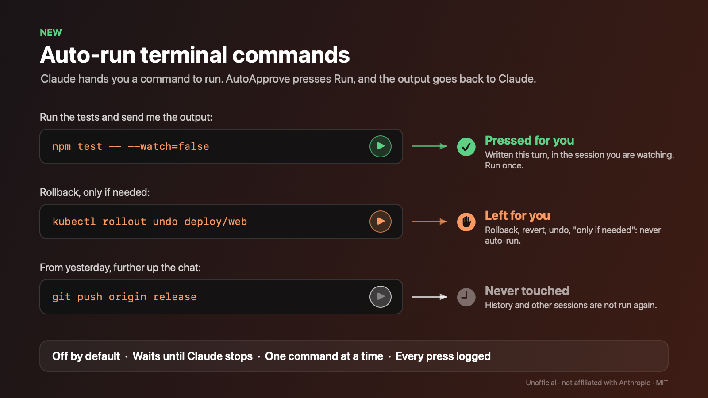

# Auto-run terminal commands



Sometimes Claude does not run a command itself. It gives you a command block with a **▷ Run in terminal and send output to Claude** button. With auto-run on, AutoApprove presses that button for you and the output goes back to Claude.

It is **off by default**. Turn it on in the menu: **Settings → Auto-run terminal commands (▷ Run button)**. It needs **Auto-approve ON** and **Clicker** on.

> ⚠️ These are often the commands Claude was not allowed to run itself (a push, for example). Auto-run removes that stop. Leave it off unless you want them run unattended.

## What gets run

| Block | What happens |
|---|---|
| Written during a turn, in the session shown in the Claude window | Run once, after Claude stops. Several new blocks run oldest first, one per second. |
| Written while you were in another session | Run when you come back to that session, if you were away less than 30 minutes. |
| Already there when the app first saw the session | Never run. |
| Revealed by scrolling up | Never run. |
| The same command text, given again in the same session | Not run again. Press the button yourself. |
| A command the app cannot read in full | Never run. |

Nothing runs in a session that is not shown in the Claude window. It waits until you open it.

## Rollbacks stay yours

A block is left for you when the command, or the sentence right before it, mentions any of these:

- rollback, roll back, roll-back
- revert, undo
- "only if", "if needed", "if necessary", "in case"
- "if it fails", "if this breaks", "if something goes wrong"

The log shows it as `skip` with the pattern that matched. The list is broad on purpose: a false match costs you one click.

To use your own list, add `autoRunSkip` to `~/.config/claude-autoapprove/state.json`, then **Reload settings**. An empty list turns the rule off. An invalid pattern counts as a match.

```json
{ "autoRunSkip": ["(?i)roll[\\s-]?back", "(?i)\\bdrop\\b", "(?i)\\bdestroy\\b"] }
```

## Risky commands

With **Settings → Still ask me for risky commands** on, a command that matches the risky list (force push, push to `main`/`master`, `rm -rf`, `sudo`, or your `askPatterns`) is left for you and logged as `ask`.

Both lists are regular expressions on text read from the screen. They are a seatbelt, not a sandbox: `eval` or `bash -c "…"` can hide a command from them.

## Log

Every decision is one line in `~/.config/claude-autoapprove/decisions.jsonl`:

```json
{"decision":"pressed","src":"run","summary":"npm test","ts":"2026-11-11T10:15:44"}
{"decision":"skip","src":"run","summary":"kubectl rollout undo deploy/web","ts":"2026-11-11T10:16:32","why":"(?i)roll[\\s-]?back"}
```

## Debug

```bash
~/Applications/AutoApprove.app/Contents/MacOS/AutoApprove --dump
```

For each Run button it prints the command it read, the sentence before it, whether the rollback rule matches, and whether Claude is working in that session.

## Limits

- Only the session shown in the Claude window. Minimized windows, other Spaces and pop-out windows are not seen.
- The rollback rule reads the element right before the block. A "Rollback" heading further up, above a neutral command, is missed.
- Commands are matched by their text. If the app restarts, everything on screen counts as history.
